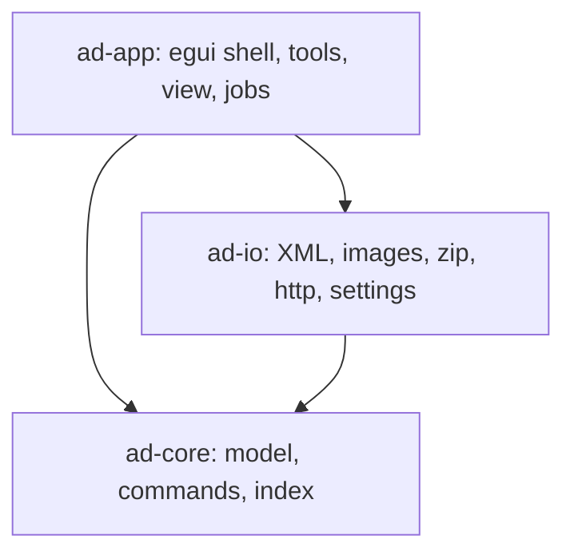
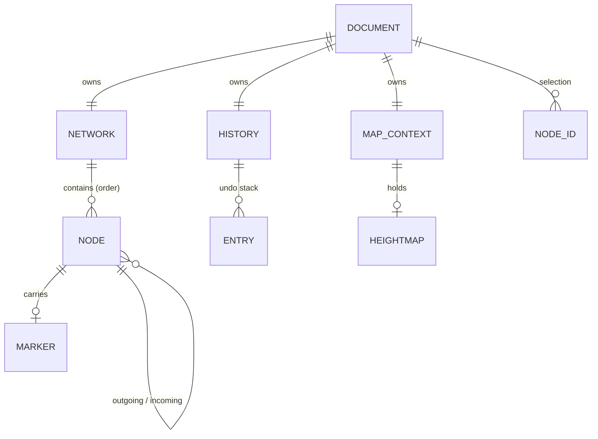
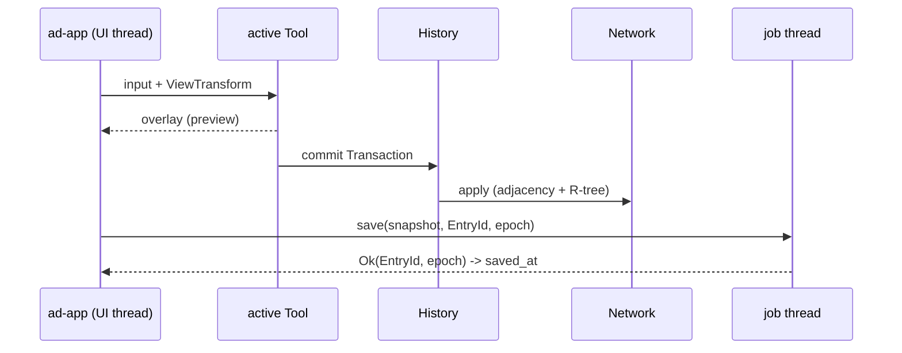

# Architecture Spine — AutoDrive Course Editor (Rust rewrite)

## Design Paradigm

The architecture is a **functional core with an imperative shell**.
- A pure core crate owns the road network model and every change to it.
- An I/O crate owns file formats, images and network access.
- A thin egui shell turns input into commands and draws the model.

Every model change is a **command** (an apply/revert pair) and runs through one history.

| Layer | Crate | Owns | May not touch |
| --- | --- | --- | --- |
| Core | `crates/ad-core` | `Document` (network, history, selection, map context, game version, epoch); `Network` (nodes, order, adjacency, markers, R-tree); `MapGeometry`, height sampling, curve math; `Command`, `History`; connection-kind derivation | egui, files, network, threads |
| I/O | `crates/ad-io` | AutoDrive config XML, `vehicles.xml`, route-manager XML, map and heightmap images (PNG, DDS, zip), downloads, settings file, file-id mapping | egui; mutating a live `Document` |
| Shell | `crates/ad-app` (binary) | eframe app, `ViewTransform`, tools, panels, menus, shortcuts, clipboard, job runner, autosave timer | XML or image parsing; mutating `Network` except through `History` |



## Invariants & Rules

### AD-1 — Crate boundaries and dependency direction

- **Binds:** all
- **Prevents:** UI or I/O code reaching into model internals and mutating them. The Java code does this through static globals such as `RoadMap.networkNodesList`, `MapPanel.zoomLevel` and `multiSelectList`.
- **Rule:**
  - The dependency direction is `ad-app → ad-io → ad-core`, plus `ad-app → ad-core`.
  - `ad-core` has no dependency on egui, eframe, file or HTTP I/O, or threads. CI enforces this with a dependency check on `ad-core`'s `Cargo.toml`.
  - No crate holds mutable global state for model or view data. The `Document` belongs to the app struct and is passed explicitly.

### AD-2 — Stable node identity; one order; file ids only at the file boundary

- **Binds:** ad-core Network, ad-io, all tools and commands
- **Prevents:** positional-id renumbering, and the resulting `MismatchedIdException` class of bugs (Java: `id == index+1`). It also prevents the save order drifting from what undo restores.
- **Rule:**
  - `NodeId` is a monotonically increasing `u64` newtype. An id is never reused, even after deletion.
  - `Network` owns `order: Vec<NodeId>`. It is the only definition of node sequence: loaded nodes in file order, then new nodes appended in creation order.
  - Deletion records each node's order position. Undo calls `Network::reinsert(id, node, order_pos)`, the only way to restore a node, under its original `NodeId` and at its original position.
  - Dense 1-based file ids exist only in `ad-io`. They are assigned from `order` at load and save. A `SaveIdMap` (`NodeId → file id`) built per save is the only source for anything that references file ids, such as marker ids and route files.

### AD-3 — Adjacency has one owner and explicit operations

- **Binds:** ad-core Network, connection tools, line and curve commit, flip, merge
- **Prevents:** the Java `createConnectionBetween` toggle, where the same call creates or deletes depending on state, and which warns it can corrupt configs. It also prevents a stored type drifting from the real adjacency.
- **Rule:**
  - Each node keeps `outgoing` and `incoming` sets exactly as the file defines them.
  - Only `Network` methods change them: `connect(a, b, shape)`, `disconnect(a, b)` and `set_shape(a, b, shape)`.
    - `shape` is `ConnectionShape { OneWay, Dual, Reverse }`.
    - Each method is idempotent and does exactly what its name says. None of them toggles.
  - Sub-priority belongs to the node, as its flag. It changes only through `SetFlag`, never through a connection operation.
  - The displayed kind (regular, subprio, dual, reverse, crossed variants) is never stored. One core function derives it from the two sets and the start node's flag.
  - Load keeps `out`/`incoming` as read, even when they disagree. A scan reports inconsistencies rather than silently repairing them.

### AD-4 — Every model mutation is a Command through one History

- **Binds:** all tools, menus, scans and fixes, paste, import
- **Prevents:**
  - edits that cannot be undone (Java: Edit Location)
  - undo restoring wrong values (Java: align to 0)
  - mixed recording styles
  - a dirty flag drifting from reality
- **Rule:**
  - `Network` is mutable only inside `Command::apply` and `Command::revert`, executed by `History`.
  - One user action is one `Transaction`, undone in one step.
  - A drag is previewed in tool state. On release it commits one command that holds the absolute before and after positions, not accumulated deltas.
  - The history is a linear stack of entries.
    - Each entry has an `EntryId` that is never reused.
    - There is a configurable cap.
    - A new command discards the redo tail.
  - `Document.saved_at: Option<EntryId>` records the last-saved entry.
    - The document is dirty exactly when the history cursor differs from `saved_at`.
    - If the cap evicts the saved entry, `saved_at` becomes `None`, and the document stays dirty until the next save.

### AD-5 — Spatial index owned by the network

- **Binds:** ad-core Network, hit-testing, culling, selection, overlap scan, snapping
- **Prevents:** O(n) scans per frame and per mouse event, and an index out of sync with the nodes.
- **Rule:**
  - `Network` keeps an `rstar` R-tree of `(x, z) → NodeId` entries. It is bulk-loaded at load.
  - The tree is updated inside the same mutation that adds, removes or moves a node. A move removes the old entry and inserts the new one.
  - Every spatial question goes through the `Network` query API: nearest node, nodes in a rectangle (inclusive bounds), nodes in a polygon, nodes within a distance, and edges near a point.

### AD-6 — Lossless config round-trip by byte splicing

- **Binds:** ad-io config reader and writer, save, autosave, backup
- **Prevents:**
  - user settings in `AutoDrive_config.xml` being lost or reformatted
  - unrelated diffs (Java turns `100.000` into `100.0` and `194.000000` into `194`, and changes the indent from 4 to 2)
  - a lost UTF-8 BOM (quick-xml drops it on read)
- **Rule:**
  - The loader keeps the original file bytes.
  - quick-xml is used only to parse the modelled elements and to locate the byte ranges of `<waypoints>` and `<mapmarker>`.
  - Save writes, in order: the original bytes before `<waypoints>`, the regenerated block, the bytes between the two blocks, the regenerated `<mapmarker>` block, and the original bytes after it. When the file has no `<mapmarker>`, the block is inserted before `</AutoDrive>`.
  - Generated blocks follow the source: indentation, line ending (CRLF or LF) and the game's number format. Coordinates have exactly 3 decimals. Marker ids are written as `N.000000`.
  - A missing `<flags>` element is generated with all zeros.
  - Save writes a temp file in the target directory and renames it into place.
  - **Golden tests:**
    - Load and save of the unedited fixture is byte-identical. The fixture is committed as non-text (see Conventions), so it keeps its CRLF line endings and BOM.
    - A second test edits the network (delete, add, connect) and checks that the saved file reloads to the same model.
    - Both must pass before any save feature merges.

### AD-7 — One implementation per coordinate and height conversion

- **Binds:** ad-core MapGeometry, ad-app ViewTransform, tools, rendering
- **Prevents:** the Java pair of non-inverse, hand-rolled conversions, and tools sampling height in different ways.
- **Rule:**
  - World coordinates are `f64` (x, y = height, z). They are rounded to 3 decimals only when written.
  - `ad-core::MapGeometry` alone converts world ↔ map pixel: 2048 px span `2048 * map_scale` world units, centred.
  - `ad-app::ViewTransform` alone converts map pixel ↔ screen. Zoom and pan are its state, and it zooms about the cursor.
  - The height of a new node comes from one `ad-core` function, `sample_height(map_context, x, z) -> Option<f64>`.
    - It ports the Java formula `((R<<8)+G)/256 / height_map_scale`.
    - `height_map_scale` is computed once at heightmap attach, as in Java, with a minimum of 1, and is guarded against empty input and division by zero.
    - It returns `None` when there is no heightmap. The file sentinel `-1` is written only by ad-io.
  - Line and curve commits use this function for every created node. A node without a sampled height interpolates linearly between the two end nodes by point index.

### AD-8 — Single-threaded immediate-mode rendering

- **Binds:** ad-app map view, tool overlays
- **Prevents:** the Java design, in which the event thread blocks on two worker threads through latches with no timeout and allocates per node per frame.
- **Rule:**
  - The map view paints on the UI thread with the egui `Painter`.
  - Visible nodes and edges come from an R-tree viewport query (AD-5). An edge is drawn when either endpoint is in view.
  - Per-frame buffers are reused, not reallocated.
  - The map image is uploaded once as a texture, and its full-size CPU copy is then dropped. The heightmap is exempt: it stays in RAM inside `MapContext` (AD-14).
  - Level-of-detail limits are named constants in one module.
  - No rendering work runs on other threads.
  - A rendering spike on the fixture must confirm the frame budget before the map-view epic locks its design.

### AD-9 — Threading: UI thread owns the Document

- **Binds:** ad-app job runner, ad-io
- **Prevents:** model or UI state being changed off the UI thread, and stale or unbounded network calls.
- **Rule:**
  - Only the UI thread holds and mutates the `Document`.
  - Long work (parse, save, decode, download) runs on background threads with owned inputs, and returns owned results through a channel that the UI polls each frame.
  - Each job captures `Document.epoch`. A result whose epoch no longer matches is dropped.
  - A result applies in exactly one of three ways:
    - a command (AD-4)
    - a whole new `Document` (AD-18)
    - a `MapAttach` that sets or replaces map image or heightmap data in `MapContext` without touching the network or the history
  - HTTP requests set connect and global timeouts and a maximum response size.

### AD-10 — Tools are stateful controllers that emit commands

- **Binds:** all toolbar tools, curves, lines, selection, widgets
- **Prevents:** preview geometry leaking into the network, previews outliving their tool, and tools mutating the model directly.
- **Rule:**
  - Exactly one tool is active. Tools implement one `Tool` trait: input events in, an optional `Command` and overlay drawing out.
  - Previews (lines, Bézier and arc curves, drag offsets, curve handles) live in tool state and are never part of `Network`.
  - Commit produces one transaction.
  - Switching tools, or replacing the document, **cancels** any uncommitted preview. Nothing commits implicitly.

### AD-11 — Game-version handling lives in ad-io

- **Binds:** ad-io, Document
- **Prevents:** version branches scattered through the code, and two coexisting version notions.
- **Rule:**
  - `GameVersion { FS19, FS22, FS25, Unknown }` is detected once at load from the config `<version>` major and stored on the `Document`.
  - A config with a root `<markerID>` (older than 1.1.0.6), or with an `Unknown` version, opens read-only with a notice. All mutating commands are disabled.
  - Only `ad-io` branches on the version:
    - the reset of flags 2 and 4 on FS22/25 load
    - the `vehicles.xml` element paths and id attribute (FS19 `FS19_AutoDrive/AutoDriveVehicleData` and `id`; FS22 `AutoDrive` and `id`; FS25 `AutoDrive` and `uniqueId`)
    - the map-image crop (FS19 full image; FS22/25 centre half, scaled to 2048²)
  - The mod-zip `descVersion` (40–53 FS19, 60–80 FS22, ≥ 90 FS25, else unsupported) is used only in image import.
  - FS25 is the verified reference. FS19 and FS22 paths are covered by unit tests.

### AD-12 — Errors are values; bad input never panics

- **Binds:** ad-core, ad-io, ad-app
- **Prevents:** half-loaded state after a malformed file, and crashes on hostile archives.
- **Rule:**
  - `ad-core` and `ad-io` return `Result` with `thiserror` enums that name the file, the element and the reason.
  - CI denies `clippy::unwrap_used` and `clippy::expect_used` in both crates.
  - A failed load or import leaves the current `Document` unchanged.
  - Zip extraction rejects absolute and `..` paths and caps entry size.
  - `ad-app` installs a panic hook that logs and shows a dialog.

### AD-13 — Port behaviour, not defects

- **Binds:** all ported features
- **Prevents:** reproducing known Java bugs for parity, or fixing them inconsistently.
- **Rule:** The following Java behaviours are fixed rather than ported. Every other deviation needs a line here.
  - The connection toggle (AD-3).
  - Positional ids (AD-2).
  - Bézier divide-by-zero at one interpolation point (AD-7).
  - Align-to-zero undo, and Edit Location without undo (AD-4).
  - Exclusive rectangle bounds (AD-5).
  - Edges into view from an off-screen node not being drawn (AD-8).
  - Zoom about the view centre (AD-7).
  - Paste losing external links. This is unchanged: paste keeps only the links inside the selection, as Java does.
  - Redo bound to Shift+Z. The default is Ctrl+Shift+Z, configurable.
  - The merge backup and autosave not touching the document path. This is kept (AD-16).

### AD-14 — MapContext is the single owner of map-level data

- **Binds:** Document, ad-io images and settings, view, tools, heightmap sampling
- **Prevents:** map scale, map name and heightmap living in several places (Java: settings, static fields, `MapImage`), and attach paths that do not fit AD-9.
- **Rule:**
  - `Document.map_context` holds the map name, `map_scale`, the map-image texture handle, `heightmap: Option<Arc<Heightmap>>` and `height_map_scale`.
  - The map name comes from one `ad-io` function: the config `<MapName>` with path and extension stripped.
  - Per-map settings (scale, node size, grid, max zoom) are keyed by that name in `Settings`. They are copied into `MapContext` at load and written back when changed.
  - A map-scale change is a setting, not a network command.
  - Images are looked up in this order:
    1. `<exe dir>/mapImages/<name>/<name>.png`
    2. `<config dir>/mapImages/<name>/<name>.png`
    3. a download from the data repository, if enabled
  - The heightmap is looked up in this order:
    1. `terrain.heightmap.png` beside the config
    2. `<name>_HeightMap.png` through the same image lookup
  - Paths are never relative to the working directory.
  - Images must be 2048×2048 or are scaled to it, and the user is told.

### AD-15 — Selection and clipboard

- **Binds:** Document selection, all tools, copy, cut, paste, delete
- **Prevents:** commands depending on transient UI state, undo leaving dangling selected ids, and a clipboard holding ids that cut has deleted.
- **Rule:**
  - `Document.selection` is a set of `NodeId`. Selection operations (rectangle, lasso, click toggle, clear) change it outside the history.
  - Commands receive explicit id lists, never `doc.selection`. After every apply and revert, the selection is pruned to existing ids.
  - A command may declare `select_after`, and undo restores the prior selection.
  - The clipboard is app-level and holds detached data: node positions relative to the selection centre, flags, markers, and internal links by index. It holds no `NodeId`s.
  - Paste creates new nodes through one transaction.
  - Hidden nodes are selectable only when "select hidden" is on.

### AD-16 — Save, autosave and backups

- **Binds:** ad-app job runner, ad-io writer, History
- **Prevents:** a background save marking newer edits as saved, and autosave or backups changing the document's path or dirty state.
- **Rule:**
  - A save request captures the current `EntryId`, a snapshot of serialisation input and the target path. Only a successful result sets `saved_at` to that captured id, and only for a matching epoch.
  - **Save As** also changes `Document.path`.
  - **Autosave** writes `<config>_autosave_<slot>.xml` with rotating slots (default every 10 min, 10 slots, both configurable). It runs only when the document is dirty and no tool preview is active. It never changes `path`, never changes `saved_at`, and never writes `vehicles.xml`.
  - **The merge backup** `<config>_mergeBackup.xml` is written before a node-merge scan applies. It follows the same restrictions as autosave.
  - All writes use temp file plus rename (AD-6).

### AD-17 — Markers, groups and parking data shape

- **Binds:** ad-core Network, ad-io config, vehicles and route XML, marker tools
- **Prevents:** marker ids, group lists and park destinations each being modelled differently by the loader, the marker tools and the vehicles writer.
- **Rule:**
  - A node carries at most one `Marker { name, group, parked_vehicles: Vec<String> }`.
  - Marker order is the node order (AD-2).
  - Groups have no table of their own in the game config. The set of groups is derived from markers. The route-manager group list is held by ad-io for that format only.
  - Renaming a group is one `RenameGroup` command over all affected markers.
  - Marker file ids and `parkDestination` values are derived at save from the `SaveIdMap` and marker order. `vehicles.xml` is rewritten only on a real Save, and only its `parkDestination` attributes change.

### AD-18 — Document replacement and epochs

- **Binds:** ad-app, all tools, job runner
- **Prevents:** a tool committing ids from a previous document, and late job results landing on a new document.
- **Rule:**
  - The document is replaced only through `App::replace_document(doc)`.
  - That call cancels the active tool's preview, clears selection, hover and the clipboard's source binding, and increments `Document.epoch`.
  - Load results use this path, and replace the history together with the network.

## Consistency Conventions

| Concern | Convention |
| --- | --- |
| Naming | Rust standard. Domain terms follow the AutoDrive format: waypoint/node, `outgoing`, `incoming`, `flag`, marker, group. Crates use the prefix `ad-`. |
| Ids | `NodeId` (monotonic `u64`) inside the app. File ids exist only in ad-io, through `SaveIdMap` (AD-2). Groups are referenced by name. `EntryId` is used for history entries. |
| Node flags | `NodeFlag(u8)` newtype that preserves any file value. `NodeFlag::REGULAR = 0` and `SUB_PRIO = 1`. Editor helper handles (curve control, rotation, radius) are tool overlay state, never nodes. |
| Units and precision | World `f64`, rounded to 3 decimals at write only. Integer map scale. Radians in code, degrees in the UI. |
| Errors | `thiserror` in libraries. `anyhow` only in `ad-app::main`. User messages come from the string table. |
| Logging | `tracing` with a `tracing-appender` rolling file in the app data dir. No `println!`. |
| Settings | One `Settings` struct (serde + `toml`) in the OS config dir (`directories`). It holds global options, per-map settings keyed by map name, and shortcuts. The default shortcut table is the Java table, except Redo (AD-13). |
| Strings | English only. All UI text lives in one string-table module. |
| Repo fixtures | `.gitattributes` marks `AutoDrive_config.xml` as `-text`, so `core.autocrlf` cannot normalise it. Tests read fixtures and write only to temp dirs. |
| Command naming | One type per user-visible action, named after it: `AddNodes`, `MoveNodes`, `Connect`, `Disconnect`, `DeleteNodes`, `SetFlag`, `EditMarker`, `RenameGroup`, `PasteNodes` and so on. Each carries its revert data. |

## Stack

| Name | Version |
| --- | --- |
| Rust (edition 2024, pinned via `rust-toolchain.toml`) | 1.99.1 |
| eframe / egui (default `wgpu` renderer) | 0.37.0 |
| quick-xml | 0.42.0 |
| image (`default-features = false`, `png`) | 0.25.10 |
| image_dds (`default-features = false`, `ddsfile`, `image`; decode only) | 0.7.2 |
| zip (`default-features = false`, `deflate`) | 9.4.0 |
| rstar | 0.14.0 |
| rfd | 0.17.2 |
| ureq (timeouts set per AD-9) | 3.5.1 |
| resvg (icons rasterised once at startup) | 0.49.0 |
| serde (`derive`) / toml | 1.0.229 / 1.2.0 |
| thiserror / anyhow | 2.0.21 / 1.0.104 |
| tracing / tracing-subscriber / tracing-appender | 0.1.44 / 0.3.23 / 0.2.5 |
| directories | 6.0.0 |

## Structural Seed

```text
Cargo.toml  rust-toolchain.toml  .gitattributes
crates/
  ad-core/src/
    network.rs              # nodes, order, adjacency, markers, R-tree, queries
    command.rs history.rs   # Command, Transaction, History, EntryId
    geometry.rs             # MapGeometry, sample_height, curve math
    document.rs             # Document, MapContext, selection, epoch
  ad-io/src/
    config_xml.rs           # splice reader and writer, SaveIdMap
    vehicles_xml.rs routes_xml.rs
    images.rs               # lookup, PNG, DDS, zip import, download
    settings.rs
  ad-app/src/
    main.rs app.rs          # eframe entry, replace_document, job runner, autosave
    view/                   # ViewTransform, map painter, overlays
    tools/                  # Tool trait, one module per tool
    ui/                     # menus, panels, dialogs, shortcuts, string table
assets/                     # SVG icons, Blank.png
```





**Deployment and operations.**
- Delivery is one Windows x64 executable (`cargo build --release`), published by a tag-triggered GitHub Actions release workflow to Releases on `weiserfuchs/AutoDrive_Course_Editor`. `mapImages/` sits next to the executable.
- The update check reads the fork's latest release. Map images download from the data repository `KillBait/AutoDrive_MapImages`.
- CI runs on every push to a branch: `cargo fmt --check`, `cargo clippy -D warnings` (plus the AD-12 lints), `cargo test` (including the golden tests in AD-6) and the AD-1 dependency check. A merge to `master` requires green CI.
- There is no server, installer or telemetry.

## Capability → Architecture Map

| Capability | Lives in | Governed by |
| --- | --- | --- |
| Load and save the config | ad-io config_xml | AD-2, AD-6, AD-11, AD-12, AD-16 |
| `vehicles.xml` parking, markers, groups | ad-io, ad-core Network | AD-17 |
| Route-manager XML | ad-io routes_xml | AD-2, AD-17 |
| Network model, connections | ad-core Network | AD-2, AD-3, AD-5 |
| Undo, redo, dirty state | ad-core History | AD-4, AD-16 |
| Autosave, merge backup | ad-app + ad-io | AD-16 |
| Map view and overlays | ad-app view | AD-7, AD-8 |
| Zoom, pan, coordinates, height | ad-core geometry, ViewTransform | AD-7, AD-14 |
| Node, connection, priority, flip, rotate, align, marker tools | ad-app tools | AD-3, AD-4, AD-10, AD-17 |
| Curves (Bézier, arc) and lines | ad-app tools + ad-core geometry | AD-7, AD-10, AD-13 |
| Selection, copy, cut, paste | Document + ad-app | AD-5, AD-15 |
| Map images, heightmap, DDS and zip import, download | ad-io images, MapContext | AD-9, AD-11, AD-14 |
| Scans (overlap, out-of-bounds, merge, consistency) | ad-core queries + commands | AD-3, AD-4, AD-5, AD-16 |
| Settings, shortcuts, per-map info, themes | ad-io settings, ad-app ui | AD-14, Conventions |
| Update check, logging, crash handling | ad-app | AD-9, AD-12 |

## Deferred

- **Undo cap value and memory budget.** Set it when commands exist; AD-4 fixes only the mechanism.
- **DDS format coverage beyond BC1–BC3 and RGBA8** (DXT2/DXT4, legacy uncompressed masks). A spike with real FS19, FS22 and FS25 DDS samples runs before the image-import epic. Missing formats get a small decoder in ad-io.
- **Localisation mechanism.** Java ships only `en_US`, and the string-table convention keeps the option open.
- **Themes.** egui light and dark stand in for FlatLaf for now.
- **Route-manager semantics in detail, and the experimental Java tools** (ArcSpline is marked WIP; ScaleButton, RoadConnection). They are sliced in their own epics and bound by AD-2, AD-3, AD-4, AD-10 and AD-17.
- **Importing settings from Java `EditorConfig.xml`.** Not planned; users start with defaults.
- **Platforms other than Windows x64.**
- **GPU instancing for very large networks.** Considered only if the AD-8 spike misses the frame budget.
- **Removing `src/main/java`.** This is the final story, after parity sign-off.
